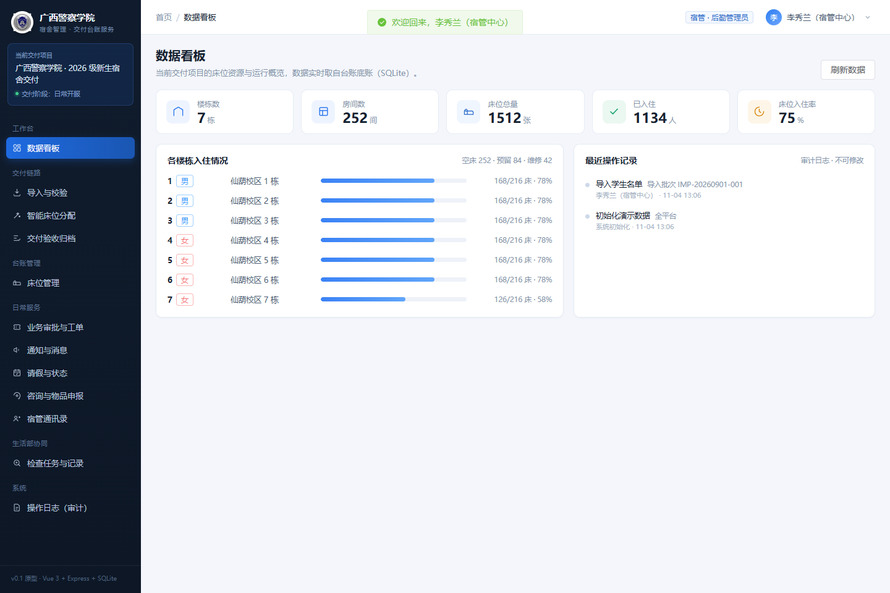
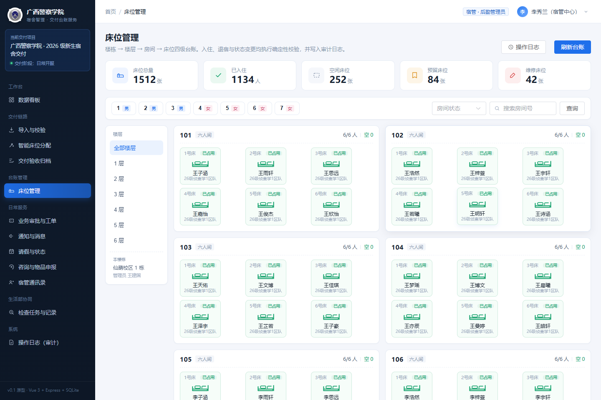
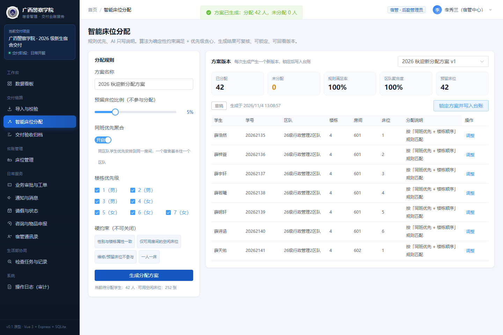
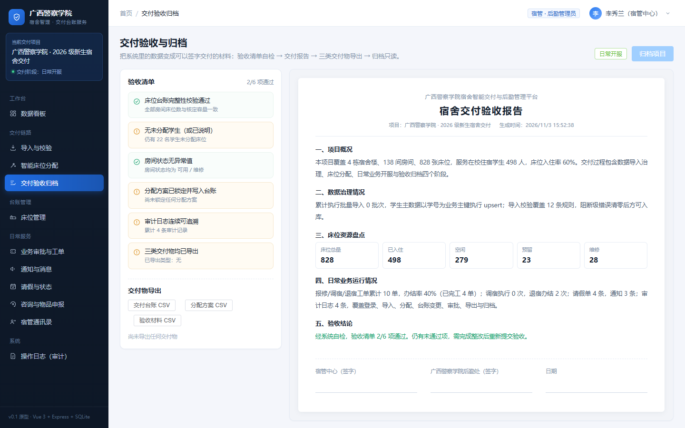
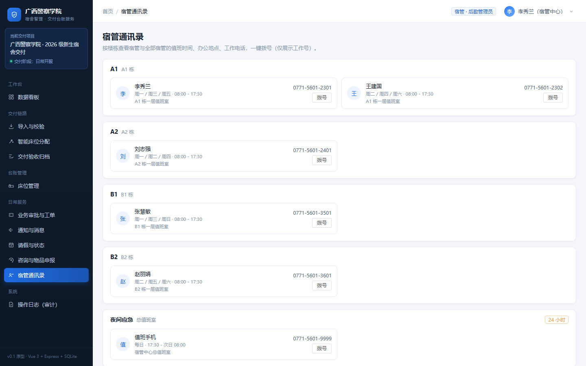
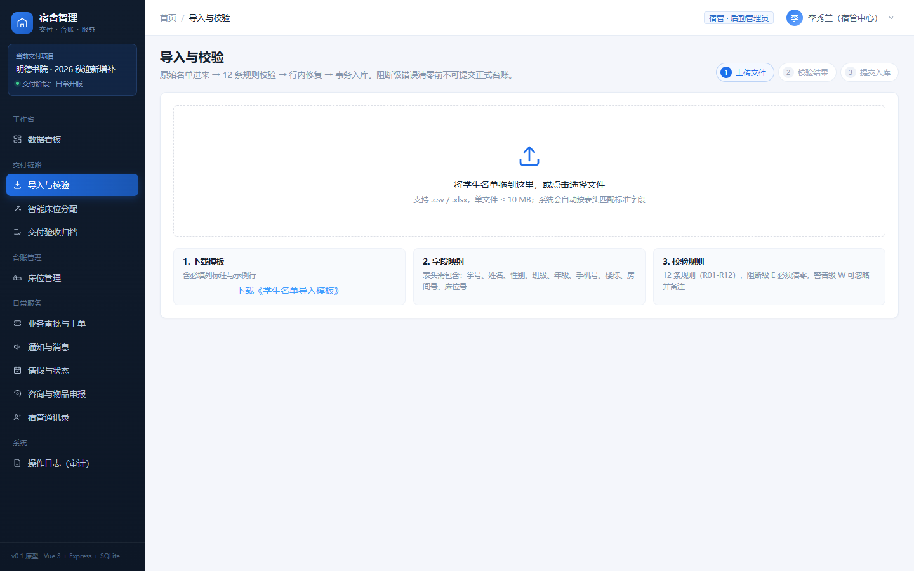
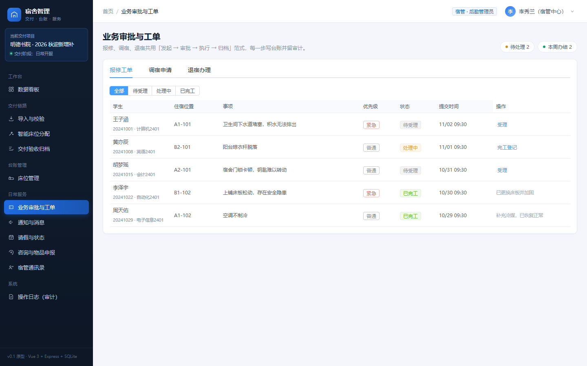
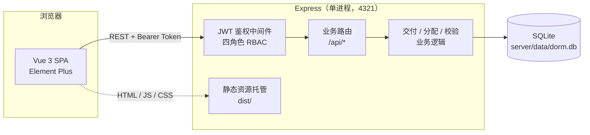

# 广西警察学院 · 宿舍智能交付与后勤管理平台

> 面向公安院校的宿舍床位「交付」全流程管理系统：从新生名单导入、智能分配到验收归档，再到日常的工单、通知、请假与检查协同，全部在一个平台内闭环。

按公安院校编制习惯设计——**以「区队」为最小组织单位，一个宿舍整间住同一区队**，从数据模型到分配算法都围绕这一点构建。

---

## 在线演示

| 项目 | 内容 |
| --- | --- |
| 访问地址 | http://8.134.187.209:4321 |
| 宿管 / 后勤管理员 | `suguan` / `123456` |
| 辅导员 | `fudaoyuan` / `123456` |
| 学生 | `20260101` / `123456` |
| 生活部 | `shenghuobu` / `123456` |

> 演示环境使用种子数据（7 栋宿舍、1512 张床位、1176 名学生、28 个区队），可自由操作，数据每日重置。

---

## 界面预览

| 登录 | 数据看板 |
| --- | --- |
|  |  |

| 床位台账 | 智能分配 |
| --- | --- |
|  |  |

| 交付验收归档 | 宿管通讯录 |
| --- | --- |
|  |  |

| 导入与校验 | 业务审批与工单 |
| --- | --- |
|  |  |

---

## 功能模块

### 交付链路

| 模块 | 能力 |
| --- | --- |
| 导入与校验 | Excel 名单导入，**12 条规则**实时校验（学号重复、床位冲突、性别与楼栋冲突、区队缺失等），错误分级为「错误 / 警告」，逐行给出修正建议；校验通过才允许落库，导入批次留痕可追溯 |
| 智能床位分配 | 按「同区队优先 → 整间预留 → 楼栋顺序」打分排布，支持预留比例、分性别分楼，一键生成方案并给出**规则满足率 / 区队聚合度 / 未分配人数**；方案可回滚 |
| 交付验收归档 | 6 项验收清单**实时计算**（床位交付、分配完成、台账导出、方案导出、材料导出、异常清零），全部通过才解锁归档；归档后进入终态，变更须走**变更单**流程 |

### 台账与日常服务

| 模块 | 能力 |
| --- | --- |
| 床位管理 | 楼栋 → 房间 → 床位三级台账，房间卡片内直接查看在住学生与所属区队，支持房态（正常 / 维修）、床位状态（已占用 / 空床 / 预留 / 维修）与调宿 |
| 业务审批与工单 | 报修、调宿、物品领用统一工单流，支持指派、处理、验收、驳回，全程状态机与超时提醒 |
| 通知与消息 | 按楼栋 / 区队定向发布，学生端签收留痕，签收率可查 |
| 请假与状态 | 学生请假申请与销假，离校 / 在校状态实时同步到台账 |
| 咨询与物品申报 | 学生在线咨询与物品申报，宿管中心统一答复归档 |
| 宿管通讯录 | 各楼栋值班员、值班日、联系电话，含夜间应急值班 |
| 生活部协同 | 检查任务下发、检查记录填报、标准库维护（支持导入学校标准） |
| 操作日志（审计） | 全量写操作留痕，记录操作人、角色、对象与变更内容，日志不可修改 |

---

## 技术栈

| 层 | 选型 |
| --- | --- |
| 前端 | Vue 3（Composition API）+ Vue Router + Element Plus + Vite 5 |
| 后端 | Node.js ≥ 22.5 + Express 4 |
| 数据库 | SQLite（Node 内置 `node:sqlite`，零外部依赖、单文件、免安装） |
| 鉴权 | JWT（12 小时有效）+ 四角色 RBAC |
| 导入导出 | SheetJS（xlsx） |

前后端一体部署：Express 同时提供 `/api/*` 接口与前端构建产物，**一个端口即完整应用**。

### 角色权限

| 角色 | 标识 | 可见范围 |
| --- | --- | --- |
| 宿管 / 后勤管理员 | `admin` | 全部模块，含分配、归档、审计 |
| 辅导员 | `counselor` | 所辖区队学生的住宿、请假、工单 |
| 学生 | `student` | 我的宿舍、报修 / 调宿、通知签收、请假、申报 |
| 生活部 | `inspector` | 检查任务与检查记录 |

---

## 系统架构



设计取舍：**不引入 ORM、不引入独立数据库服务**，用 Node 22 内置的 `node:sqlite` 直连单文件数据库，整套系统只需一个 Node 进程即可运行——部署成本低，迁移时拷贝一个文件即可。

---

## 快速开始

```bash
# 1. 环境要求：Node.js >= 22.5（使用了内置 node:sqlite）
node -v

# 2. 安装依赖
npm install

# 3. 构建前端
npm run build

# 4. 启动（前端 + API 同端口）
npm start
```

打开 http://127.0.0.1:4321 即可。首次启动会自动建表并写入种子数据（7 栋 / 252 间房 / 1512 床 / 1176 名学生 / 28 个区队）。

数据库文件位于 `server/data/dorm.db`，**删除该文件即可恢复到初始演示状态**。

### 开发模式

```bash
npm run dev   # 直接运行后端（修改前端后需重新 npm run build）
```

---

## 目录结构

```
.
├── index.html                # Vite 入口
├── vite.config.js
├── package.json
├── public/                   # 静态资源（校徽、favicon）
├── src/
│   ├── main.js
│   ├── api.js                # axios 封装与 token 注入 / 401 拦截
│   ├── router.js
│   ├── styles.css            # 全局设计变量
│   └── views/                # 15 个页面
│       ├── Login.vue  Layout.vue  Dashboard.vue
│       ├── Import.vue  Allocate.vue  Delivery.vue   # 交付链路
│       ├── Beds.vue                                  # 台账
│       ├── Tickets.vue  Notices.vue  Leaves.vue      # 日常服务
│       ├── Services.vue  Contacts.vue  Inspections.vue
│       ├── MyDorm.vue                                # 学生端
│       └── Audit.vue                                 # 审计
├── server/
│   ├── index.js              # Express 入口、鉴权、静态托管
│   ├── db.js                 # 建表、种子数据、口令哈希
│   └── extra.js              # 业务路由（导入校验 / 分配 / 归档 / 工单 / 检查…）
└── docs/
    ├── 项目说明与演示手册.md
    └── screenshots/
```

---

## 页面与路由

采用 hash 路由（`/#/dashboard`），无需服务端 rewrite 配置；每条路由带 `meta.roles`，路由守卫在跳转前校验角色，越权访问统一回落到首页。

| 路由 | 页面 | 可访问角色 |
| --- | --- | --- |
| `/login` | 登录 | 公开 |
| `/dashboard` | 数据看板 | 宿管、辅导员 |
| `/beds` | 床位管理（台账） | 宿管 |
| `/import` | 导入与校验 | 宿管 |
| `/allocate` | 智能床位分配 | 宿管 |
| `/delivery` | 交付验收归档 | 宿管 |
| `/tickets` | 业务审批与工单 | 宿管、辅导员 |
| `/inspections` | 生活部协同（检查） | 宿管、辅导员、生活部 |
| `/notices` | 通知与消息 | 宿管、辅导员、学生 |
| `/leaves` | 请假与状态 | 宿管、辅导员、学生 |
| `/services` | 咨询与物品申报 | 宿管、辅导员、学生 |
| `/contacts` | 宿管通讯录 | 宿管、辅导员、学生 |
| `/audit` | 操作日志（审计） | 宿管 |
| `/my-dorm` | 我的宿舍 | 学生 |

---

## 数据模型

22 张表，核心关系：

```
buildings (楼栋)
  └── rooms (房间)
        └── beds (床位)  ── 占用 ──▶  students (学生)
                                        │
allocations (分配方案) ── allocation_items ──┘
                      
project (交付项目)   users (账号)   audit_logs (审计)
tickets (工单)  notices + notice_receipts (通知/签收)  leaves (请假)
consultations (咨询)  declarations (申报)  duty_schedule (值班)
inspection_tasks / inspection_records / standard_items / regulations (检查)
import_batches (导入批次)  export_records (导出留痕)  change_orders (变更单)
```

关键设计：

- **床位是唯一的分配单元**，`beds.student_id` 与 `students` 一对一，天然避免重复占床
- **区队即 `students.class_name`**（如「26级网络安全与执法1区队」），不额外建表，避免过度设计
- **归档后进入终态**，任何数据变更须经 `change_orders` 记录原因与明细，保证交付结果可审计

---

## 关键实现

### 1. 导入校验（12 条规则）

`server/extra.js` 中的 `validateRows()`，每条规则带 `ruleId / level / field / message / suggestion`，前端按级别着色并逐行给出修正建议。落库前二次校验，校验不通过则不写库。

### 2. 智能分配

```
评分 = 同区队加成(+1000) + 空房加成(+100) - 房内已住人数 - 楼栋顺序权重 + 床位号偏好
```

- 优先整间分配给同一区队，保证「一室一区队」
- 预留按**整间**预留，避免把一个区队劈成两半
- 输出指标：规则满足率、区队聚合度、未分配人数

### 3. 交付验收清单

后端每次请求**实时计算**，不做缓存；前端在导出、提交变更单等操作后立即全量刷新，并对窗口重新聚焦做节流刷新，避免出现「操作已完成但清单还显示未通过」的状态滞后。

---

## 部署

### Linux（systemd）

```ini
[Unit]
Description=Dorm Platform
After=network-online.target

[Service]
WorkingDirectory=/opt/dorm-platform
EnvironmentFile=/opt/dorm-platform/.env
ExecStart=/usr/local/bin/node server/index.js
Restart=always
RestartSec=3

[Install]
WantedBy=multi-user.target
```

`.env` 中至少配置：

```env
NODE_ENV=production
PORT=4321
JWT_SECRET=<随机 40 位以上字符串>
```

```bash
npm install && npm run build
systemctl enable --now dorm-platform
```

### Windows（本机常驻）

项目附带 `daemon.mjs`：崩溃 3 秒自动重启、防重复实例、日志写入 `server/data/daemon.log`，可配合任务计划或注册表 `Run` 键实现开机自启。

---

## 数据备份

整个平台的数据就是**一个文件**：

```bash
cp server/data/dorm.db /backup/dorm-$(date +%F).db
```

---

## 常见问题

| 现象 | 原因与处理 |
| --- | --- |
| 启动报 `Cannot find module 'node:sqlite'` | Node 版本低于 22.5，升级 Node 即可（`node -v` 确认） |
| 页面打开是空白 / 404 | 没有构建前端，先执行 `npm run build` 再启动 |
| 端口 4321 被占用 | `PORT=4400 npm start` 换端口，或结束占用进程 |
| 想恢复初始演示数据 | 停止服务 → 删除 `server/data/dorm.db` → 重启，会自动重新建表并写入种子数据 |
| 登录后立刻被踢回登录页 | token 过期（12 小时）或 `JWT_SECRET` 变更，重新登录即可 |
| 修改前端后页面没变化 | 静态资源来自 `dist/`，需重新 `npm run build`（不需要重启服务） |

---

## 说明

- 本项目为教学与竞赛演示用途，种子数据中的人名、学号、电话均为程序生成，不对应真实人员
- 校徽等标识仅用于校园场景演示，版权归广西警察学院所有
- 演示环境账号口令为弱口令，正式使用前请修改 `server/db.js` 的种子口令、移除登录页预填账号，并更换 `JWT_SECRET`
